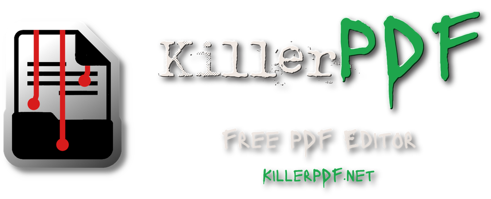

<p align="center">
  <a href="https://jpdfs.net"></a>
</p>

<h1 align="center">JPDFs</h1>

<p align="center">
  A free, open-source PDF editor for Windows.
</p>

<p align="center">
  <a href="https://jpdfs.net">Official website</a> ·
  <a href="https://jpdfs.net/help">User guide</a> ·
  <a href="https://github.com/JPDFs/JPDFs/releases">Downloads and releases</a>
</p>

JPDFs lets you read, annotate, edit, organize, sign, redact and convert PDF documents in one Windows application. It works locally and does not require an account.

This repository contains the application source code and the Windows scripts used to build its installer.

## Features

- Read PDFs using tabs, split panes, search and bookmarks.
- Annotate pages and edit supported text.
- Merge, split, extract, reorder, rotate, crop and compare documents.
- Run OCR on scanned pages and create searchable PDFs.
- Convert documents between PDF, Office formats, HTML, Markdown, text, JSON and images.
- Create and fill forms, redact content, protect files and work with digital signatures.
- Automate repeated tasks using macros, watched folders and command-line tools.

See the [application README](src/README.md) for screenshots, the complete feature list, known limitations, documentation and license information.

## Download

For normal use, download a ready-to-install or portable build from the [official JPDFs website](https://jpdfs.net) or the [GitHub releases page](https://github.com/JPDFs/JPDFs/releases).

## Build the installer on Windows

### Requirements

- Windows.
- The .NET SDK version required by `src/global.json`.
- A complete clone of this repository.

### Quick build

1. Clone or download this repository.
2. Open the repository folder in Windows.
3. Run **`Compilar-J-PDFs.cmd`**.
4. Wait for the script to finish. It checks the build result and displays the installer size and SHA-256 hash.

If the build succeeds, the installer is copied to the repository root as:

```text
J-PDF's Setup.exe
```

### Build with PowerShell

You can also run the script directly from PowerShell:

```powershell
.\Build-JPDFs-Installer.ps1
```

To choose the build configuration:

```powershell
.\Build-JPDFs-Installer.ps1 -Configuration Release
.\Build-JPDFs-Installer.ps1 -Configuration Debug
```

The script invokes the packaging process in `src/build/build-portable.ps1`, validates the expected installer output and copies it to the repository root. The generated installer is placed in the root directory; intermediate build files remain under `src/bin`.

### Build the application without the installer

For the application build and test commands, open a terminal in the `src` directory and follow the instructions in [src/README.md](src/README.md#build-and-test).

## Repository layout

```text
j-pdfs/
├── Build-JPDFs-Installer.ps1   # PowerShell installer build
├── Compilar-J-PDFs.cmd         # Windows double-click build entry point
└── src/
    ├── JPDFs.csproj            # Main application project
    ├── build/                  # Build and packaging scripts
    ├── docs/                   # README images and documentation assets
    └── README.md               # Application features, development and license
```

## License

The application is distributed under the GNU General Public License v3.0. Read the [license file](src/LICENSE) for the full terms and notices.
